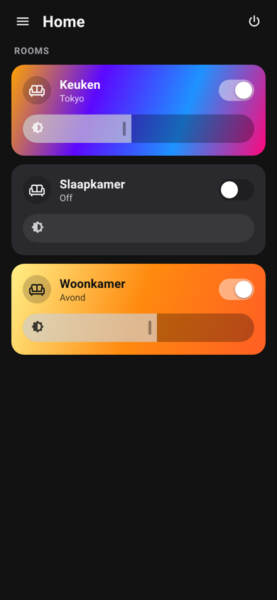
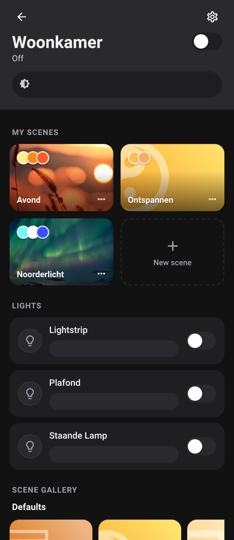
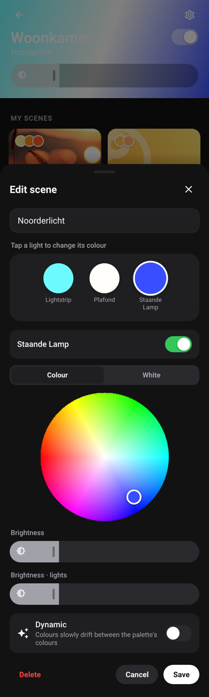
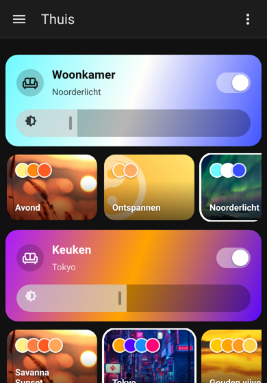

# Room Scenes

Hue-style room scenes for Home Assistant. No bridge or vendor app required.

Room Scenes builds on your Home Assistant **areas**. Every area with lights becomes a room with its own
scenes, a brightness slider and a gradient that shows what the lights are doing right now. Scenes are
real `scene.*` entities, so you can use them in dashboards, automations, voice assistants and on remotes.

<p>
  
  
  
  
</p>

## Features

- **Rooms from your areas.** Lights are picked up automatically, including lights on devices in that area.
- **My scenes per room.** You can save the current lights, a gallery preset, or a scene you build light by light with a colour wheel and white-temperature slider. Edits preview live on your lamps.
- **Scene gallery.** Includes the full preset collection from [Scene Presets](https://github.com/Hypfer/hass-scene_presets). Tap one to try it in the room, then save it as a scene.
- **Dynamic scenes.** Colours slowly drift through a preset's palette.
- **Active scene tracking.** The room shows which scene is on. It clears the scene as soon as someone changes a light.
- **Relative room brightness.** Like Hue, the room slider scales all lights relative to each other instead of setting them all to the same level.
- **Scene entities.** One `scene.<room>_<scene>` per scene, already placed in the right area.
- **Zigbee2MQTT scene sync (optional).** Scenes can be stored *on the lamps* as native Zigbee scenes. Recall then uses one group command, so lamps switch in sync with no "popcorn" effect, and it works even when Home Assistant is down.
- **Lovelace card.** `custom:room-scenes-card` shows a room tile plus its scenes. It loads automatically, so you don't need to add a resource.
- English and Dutch UI, light and dark theme.

## Installation (HACS)

1. HACS → ⋮ → *Custom repositories* → add this repository as type **Integration**.
2. Install **Room Scenes** and restart Home Assistant.
3. *Settings → Devices & services → Add integration → Room Scenes*.
4. Open **Room Scenes** in the sidebar.

Make sure your lights are assigned to areas. Room Scenes only shows areas that contain at least one light.

## Zigbee2MQTT scene sync

1. Create a Zigbee2MQTT group with the lamps of a room. You probably already have one if you use binding.
2. In Room Scenes, open the room → ⚙ → pick the group. A matching group is marked *(suggested)*.
3. Save or re-save a scene. Room Scenes puts the lamps in the scene's state and sends `scene_store` to the group.

When you activate the scene, Room Scenes sends a single `scene_recall` to the group. Room lights that are
not in the group are still set through Home Assistant. Dynamic scenes always run through Home Assistant.

Each Zigbee group gets its own scene IDs (1–254). Deleting a scene also removes it from the lamps.

## Remote: cycle through scenes

Map a button (for example the Hue button on a Hue dimmer) to:

```yaml
action: room_scenes.cycle_scenes
data:
  area_id: keuken
```

The scene order can be changed under room settings (⚙).

## Services

| Service | Purpose |
|---|---|
| `room_scenes.activate_scene` | Activate by room scene ID or `scene.*` entity |
| `room_scenes.cycle_scenes` | Next scene in a room |
| `room_scenes.set_room_brightness` | Relative room brightness (1–100 %) |
| `room_scenes.apply_preset` | Apply a gallery preset to any target (Scene Presets compatible) |
| `room_scenes.start_dynamic_scene` / `stop_*` | Dynamic scenes (Scene Presets compatible) |

## Dashboard card

```yaml
type: custom:room-scenes-card
area: woonkamer
show_scenes: true        # optional, default true
tap_action: open_panel   # or "none"
```

## Development

```bash
npm install
npm run build      # builds custom_components/room_scenes/frontend/*.js
npm run watch
```

The frontend uses Preact and esbuild and is fully self-styled, so it doesn't depend on internal Home Assistant
elements apart from `ha-icon` and `ha-card`.

## Credits

This is a fork of [Hypfer/hass-scene_presets](https://github.com/Hypfer/hass-scene_presets) (Apache-2.0).
The preset collection, colour logic and dynamic scenes come from there. Room Scenes is not affiliated with
Signify or Philips Hue.
